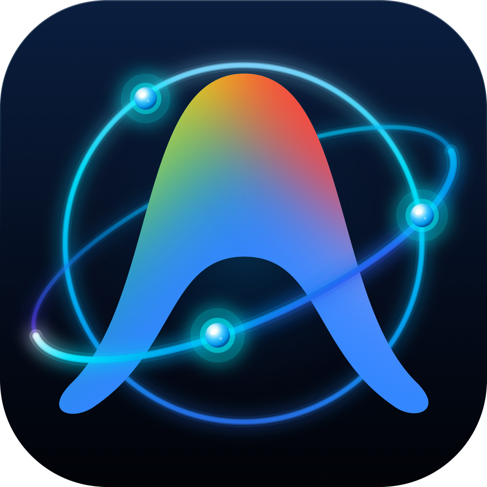

# ⚡ Antigravity Orbit (macOS)

<p align="center">
  
  <br>
  <em>Ứng dụng Menu Bar macOS mã nguồn mở tối ưu, tự động giám sát quota và xoay vòng tài khoản Google AI Pro / Ultra cho Antigravity IDE, agy CLI & Antigravity Desktop App</em>
</p>

<p align="center">
  <a href="https://github.com/phucduong/AntigravityOrbit"></a>
  
  
  
  <a href="LICENSE"></a>
</p>

---

## 📖 Giới thiệu

**Antigravity Orbit** là dự án mã nguồn mở (Open Source) native 100% bằng **Swift & AppKit** dành cho hệ điều hành macOS, hoạt động trực tiếp và tinh gọn trên thanh trạng thái (Menu Bar). 

Ứng dụng được sinh ra nhằm giải quyết triệt để vấn đề gián đoạn công việc khi lập trình viên sử dụng các mô hình Google AI (Gemini 3.8 Flash, Claude Sonnet/Opus 4.6, GPT-OSS 120B...) trên **Antigravity IDE**, **agy CLI** và **Antigravity Desktop App**.

Thay vì phải theo dõi hạn mức thủ công hay bất ngờ bị chặn request khi cạn token/quota, **Antigravity Orbit** liên tục cập nhật hạn mức thực tế, tự động kích hoạt cơ chế **xoay vòng thông minh (Smart Round-Robin Orbit)** sang tài khoản dự phòng có quota tốt nhất, đồng thời đồng bộ tức thời 3 chiều để luồng làm việc của bạn luôn trơn tru và liên tục 24/7.

---

## 🌟 Tính năng nổi bật

### 1. Thanh trạng thái Tinh gọn & Thân thiện với màn hình "Tai thỏ" (Notch-Friendly)
* **Hiển thị trực quan**: Cực kỳ gọn gàng với biểu tượng Orbit đặc trưng và phần trăm quota kèm chấm trạng thái màu:
  * `[Logo Orbit] 70% 🟢`: Hạn mức an toàn ($> 30\%$).
  * `[Logo Orbit] 25% 🟡`: Hạn mức cảnh báo ($10\% - 30\%$).
  * `[Logo Orbit] 8% 🔴`: Hạn mức tới hạn ($\le$ ngưỡng kích hoạt xoay vòng).
  * `[Logo Orbit] ERR 🔴`: Lỗi xác thực hoặc token hết hạn.
  * `[Logo Orbit] --% ⚪`: Chưa kích hoạt tài khoản nào (trạng thái chờ / standby).
* **Tooltip chi tiết khi rê chuột (Hover)**:
  ```text
  Antigravity Orbit: developer@gmail.com
  Model: Gemini 3.8 Flash (High)
  (5h: 70% • Tuần: 92%)
  ```
* Tối ưu không gian hiển thị, không lo bị ẩn hay đè khuất trên các dòng MacBook có tai thỏ (MacBook Pro 14"/16", MacBook Air M2/M3/M4).

---

### 2. Giám sát Quota Đa Tầng & Tự động Làm mới Token (Proactive Token Refresh)
* **Kiểm soát đồng thời 2 chu kỳ**:
  * **Quota 5 giờ**: Giám sát sát sao chu kỳ rolling 5 giờ (`gemini-5h`, `3p-5h`).
  * **Quota tuần**: Kiểm soát hạn mức tuần (`gemini-weekly`, `3p-weekly`).
* **Động cơ Hybrid Quota**:
  * Ưu tiên truy vấn trực tiếp qua Local Proxy Service (`http://127.0.0.1:8045/api/accounts`).
  * Tự động dự phòng truy vấn qua Google Cloud Code PA API nội bộ khi local proxy không khả dụng.
* **Proactive Token Refresh**: Tự động phát hiện access token sắp hết hạn ($\le 120$ giây) hoặc phản hồi mã lỗi `401 Unauthorized` để gọi Google OAuth Endpoint làm mới access token tự động mà không làm gián đoạn IDE.

---

### 3. Xoay vòng tài khoản Thông minh & Đồng bộ 3 Chiều (3-Way Target Sync)
* **Thuật toán xoay vòng Round-Robin chọn lọc**:
  * Quét các tài khoản theo vòng tròn khép kín.
  * Chỉ chuyển sang tài khoản có quota lớn hơn ngưỡng cảnh báo đã thiết lập.
  * Trong trường hợp tất cả tài khoản đều dưới ngưỡng, ứng dụng tự động chọn tài khoản có tỷ lệ token còn lại cao nhất.
* **Đồng bộ đồng thời 3 nền tảng**:
  1. `--target classic`: Antigravity Desktop App.
  2. `--target ide`: Antigravity IDE.
  3. `--target agy`: agy CLI trong Terminal.
* **Chuyển đổi thủ công 1-Click**: Bấm vào bất kỳ tài khoản nào trên menu để chuyển ngay, hoặc nhấn phím tắt `⌘R` để xoay vòng sang tài khoản tiếp theo.

---

### 4. Tự động Nhận diện Gói cước (Subscription Tier) & AI Model Đang hoạt động
* **Nhận diện chính xác gói Google AI**:
  * Tích hợp Google Code Assist API để bóc tách gói dịch vụ thực tế: **Google AI Pro**, **Google AI Ultra**, **Google Cloud / Enterprise**, hoặc **Miễn phí (Free)**.
* **Phát hiện Model AI thực tế trong Antigravity**:
  * Đọc trực tiếp cấu hình IDE từ file `~/.gemini/antigravity/antigravity_state.pbtxt`.
  * Chuẩn hoá tên hiển thị các model mới nhất:
    * `Gemini 3.8 Flash (High / Medium / Low / Tiered)`
    * `Gemini 3.1 Flash Lite`
    * `Claude Opus 4.6 (Thinking)` / `Claude Sonnet 4.6 (Thinking)`
    * `Claude Opus 5.5 (High / Medium)`
    * `GPT-OSS 120B (Medium)`
* **Bảo toàn trạng thái Model giữa các tài khoản**: Tài khoản đang active hiển thị model theo thời gian thực của IDE, trong khi các tài khoản dự phòng duy trì cấu hình model độc lập của riêng mình.

---

### 5. Giao diện Popover Dashboard Hiện đại (Status Popover 1-Click)

Nhấp vào icon Menu Bar để mở Popover Dashboard với hiệu ứng kính mờ (Vibrancy) đậm chất macOS:

```text
┌────────────────────────────────────────────────────────┐
│ (Avt) Happy Duong           Google AI Pro  [🔄] [⚙️] [⎋]│
├────────────────────────────────────────────────────────┤
│ ┌────────────────────────────────────────────────────┐ │
│ │ 5 Giờ   [████████████████░░░░]  85% (Reset: 2h 15m)│ │
│ │ Tuần    [████████████████████]  92% (Reset: 3d 14h)│ │
│ │                                                    │ │
│ │ Model: [ 🤖 Gemini 3.8 Flash (High)              ▾]│ │
│ └────────────────────────────────────────────────────┘ │
│                                                        │
│ TÀI KHOẢN DỰ PHÒNG (2)                      Quản lý... │
│ ┌────────────────────────────────────────────────────┐ │
│ │ 🟢 (Avt) Secondary Account         96%             │ │
│ │    5h: 96% • Tuần: 90%                             │ │
│ ├────────────────────────────────────────────────────┤ │
│ │ 🟡 (Avt) Backup Account            22%             │ │
│ │    5h: 22% • Tuần: 45%                             │ │
│ └────────────────────────────────────────────────────┘ │
│                                                        │
│ [ 🔄 Xoay vòng (⌘R) ]         Tự xoay vòng (<10%) [ON] │
└────────────────────────────────────────────────────────┘
```

* **Hero Card nổi bật**: Tài khoản active hiển thị dạng Card riêng biệt, tích hợp trực quan thanh tiến trình hạn mức 5h (kèm thời gian đếm ngược Reset) và hạn mức tuần.
* **1-Click Switching**: Đổi Model hoặc nhấp vào bất kỳ tài khoản dự phòng nào để chuyển đổi tức thời (loại bỏ hoàn toàn ác mộng menu con đa tầng).
* **Instant Tooltips**: Tooltip động có mũi tên (Dynamic Arrow Tooltip) phản hồi tức thì khi rê chuột lên các nút thanh công cụ và hàng tài khoản.

---

### 6. Cửa sổ Cài đặt Chuẩn macOS System Settings (Settings Window - `⌘,`)

Giao diện cửa sổ native với bố cục **Split-View Sidebar** hiện đại chuẩn macOS Ventura, Sonoma và Sequoia (tối ưu kích thước linh hoạt từ 720 x 520 px, co giãn mượt mà trên màn hình nhỏ):

```text
┌────────────────────────────────────────────────────────────────────────────────────────┐
│  CÀI ĐẶT - TÀI KHOẢN (ACCOUNTS CONFIGURATION)                                          │
├────────────────────────────────────────────────────────────────────────────────────────┤
│                                                                                        │
│  Quản lý Tài khoản (3 tài khoản)             [⟳ Cập nhật Quota]  [+ Thêm tài khoản ▾]  │
│  Theo dõi hạn ngạch thực tế và thiết lập thứ tự xoay vòng      [Toggle: Hiện Alias ✓]  │
│                                                                                        │
│  ────────────────────────────────────────────────────────────────────────────────────  │
│                                                                                        │
│  ⭐ TÀI KHOẢN ĐANG HOẠT ĐỘNG                             Tự động đồng bộ IDE & agy     │
│  ┌──────────────────────────────────────────────────────────────────────────────────┐  │
│  │ (Avt)  Happy Duong (Work)  [Google AI Pro]               [🟢 ĐANG SỬ DỤNG]        │  │
│  │        work.email@gmail.com                                                      │  │
│  │                                                                                  │  │
│  │  Hạn mức 5 giờ:                    Reset sau 2h 15m               85%            │  │
│  │  [██████████████████████████████████████████░░░░░░░░] (Xanh lá)                  │  │
│  │                                                                                  │  │
│  │  Hạn mức Tuần:                     Reset sau 3d 14h               92%            │  │
│  │  [████████████████████████████████████████████░░░░░░] (Xanh dương)               │  │
│  │                                                                                  │  │
│  │  Model: [ 🤖 Gemini 3.8 Flash (High) ▾]                     [✏️ Sửa tên gợi nhớ]  │  │
│  └──────────────────────────────────────────────────────────────────────────────────┘  │
│                                                                                        │
│  TÀI KHOẢN DỰ PHÒNG (2)                      🎯 Kế tiếp: Secondary • 96% token         │
│  ┌──────────────────────────────────────────────────────────────────────────────────┐  │
│  │ 🟢 (Avt) Secondary Account       [Google AI Pro]       [⚡ Kích hoạt] [✏️] [🗑️]   │  │
│  │          secondary@gmail.com                                                     │  │
│  │  ──────────────────────────────────────────────────────────────────────────────  │  │
│  │  Model: [ 🤖 Gemini 3.8 Flash ▾]       5h: 96% • 4h 10m       Tuần: 90% • 5d     │  │
│  └──────────────────────────────────────────────────────────────────────────────────┘  │
│                                                                                        │
│  💡 Cơ chế thông minh: Khi hạn ngạch 5h của tài khoản đang dùng xuống dưới ngưỡng cài   │
│     đặt, hệ thống tự động xoay vòng sang tài khoản có hạn ngạch cao nhất.              │
└────────────────────────────────────────────────────────────────────────────────────────┘
```

#### 📁 Cột Sidebar Trái (Navigation - 200px)
* 👥 **Tài khoản (Accounts)**: Quản lý danh sách tài khoản, thêm mới, phân quyền model (kèm badge đếm số lượng tài khoản theo thời gian thực).
* 🔄 **Xoay vòng (Rotation)**: Cấu hình ngưỡng cảnh báo và tần suất quét hạn mức.
* ⚙️ **Hệ thống (System)**: Ngôn ngữ hiển thị (10 ngôn ngữ), Khởi động cùng máy tính, Thông báo & Âm thanh.
* ℹ️ **Thông tin (About)**: Phiên bản, tác giả, giấy phép mã nguồn mở MIT và mã nguồn dự án.

#### 👥 Tab 1: Quản lý Tài khoản (Accounts)
* **Thẻ Hero Tài khoản Active (`SettingsActiveHeroCard`)**:
  * Đặt trang trọng ở đầu trang với viền/nền xanh lá nổi bật, nhận diện tức thì tài khoản đang gánh tải.
  * Hiển thị Avatar lớn (32px), Tên gợi nhớ, Tag gói (`Google AI Pro`, `Google AI Ultra`), Email và Badge trạng thái **`🟢 ĐANG SỬ DỤNG`**.
  * **Thanh đo Quota đa tầng có Countdown Reset**: Hiển thị hạn mức 5h & Tuần với màu sắc đổi động theo ngưỡng cảnh báo, số % `SF Mono` sắc nét và **thời gian đếm ngược Reset** (`Reset sau 2h 15m`, `Reset sau 3d 14h`).
  * Dropdown chọn AI Model trực tiếp kèm nút sửa tên gợi nhớ.
* **Thẻ Tài khoản Dự phòng 2 Tầng (`SettingsStandbyAccountRow`)**:
  * **Thiết kế tối ưu cho màn hình nhỏ**: Cấu trúc 2 tầng phân cấp rõ ràng, chống hiện tượng ngắt dòng text, rớt dấu `%` hay co cụm nút bấm trên các màn hình MacBook 13"/14".
  * **Tầng 1 (Danh tính & Thao tác)**: Chấm đèn giao thông 🟢/🟡/🔴 + Avatar 26px + Tên tài khoản + Nhãn gói không rớt dòng + Email, cùng cụm nút hành động bên phải: Nút **`[⚡ Kích hoạt]`** cố định 1 dòng, nút **Sửa tên (✏️)** và **Xóa (🗑️)**.
  * **Tầng 2 (Cấu hình & Chỉ số)**: Menu chọn Model AI ưu tiên (`🤖 Model ▾`) rộng rãi bên trái + Các badge hạn ngạch 5h & Tuần kèm thời gian đếm ngược Reset bên phải.
* **Thanh công cụ Toolbar & Chỉ báo Trực quan**:
  * **Nút Làm mới Quota**: Kèm hiệu ứng xoay 360° đồng bộ với Popover.
  * **Menu Thêm tài khoản (+)**: Hỗ trợ Đăng nhập Google OAuth trình duyệt, Import từ Antigravity IDE, và Import từ tệp JSON.
  * **Chú giải đèn trạng thái (Status Legend)**: Hướng dẫn nhanh quy ước màu quota (`>30%`, `≤30%`, `≤ngưỡng`).
  * **Dự báo tài khoản kế tiếp**: Huy hiệu hiển thị tài khoản sẽ được ưu tiên chọn trong lượt xoay vòng tiếp theo.
  * **Thẻ ghi chú thông minh (Smart Tip)**: Giải thích cơ chế tự động xoay vòng ở cuối danh sách.

#### 🔄 Tab 2: Xoay vòng (Rotation)
* **Tự động xoay vòng tài khoản**: Công tắc Native Switch bật/tắt tính năng xoay vòng thông minh khi chạm ngưỡng.
* **Ngưỡng kích hoạt xoay vòng**: Dải nút chọn nhanh mức hạn mức cảnh báo (`5%`, `10% - Khuyên dùng`, `15%`, `20%`, `25%`).
* **Tần suất quét Quota**: Tùy chọn chu kỳ làm mới dữ liệu tự động (`30 giây`, `60 giây (Mặc định)`, `2 phút`, `5 phút`).

#### ⚙️ Tab 3: Hệ thống (System)
* **Ngôn ngữ hiển thị**: Danh sách 10 ngôn ngữ giao diện (có quốc kỳ đại diện).
* **Khởi động cùng máy tính (Launch at Login)**: Công tắc Native Switch tự động chạy ngầm khi bật máy Mac qua `SMAppService`.
* **Thông báo hệ thống (Notifications)**: Gửi thông báo Notification Center khi xoay vòng thành công.
* **Âm thanh thông báo**: Tùy chọn phát âm thanh khi xoay vòng.
* **Phím tắt khởi động nhanh**: Nút mở nhanh **Antigravity Desktop App** và **Antigravity IDE**.

---

### 7. Hỗ trợ Đa Ngôn Ngữ Toàn Diện (10 Ngôn ngữ)
Toàn bộ giao diện trên Menu Bar, Cửa sổ Cài đặt, Cửa sổ Giới thiệu và Thông báo đẩy đều được hỗ trợ hoàn chỉnh 10 ngôn ngữ:
* 🇻🇳 **Tiếng Việt** (Mặc định)
* 🇺🇸 **English**
* 🇨🇳 **简体中文** (Simplified Chinese)
* 🇯🇵 **日本語** (Japanese)
* 🇰🇷 **한국어** (Korean)
* 🇪🇸 **Español** (Spanish)
* 🇫🇷 **Français** (French)
* 🇩🇪 **Deutsch** (German)
* 🇵🇹 **Português** (Portuguese)
* 🇷🇺 **Русский** (Russian)

Chuyển đổi ngôn ngữ có hiệu lực **ngay lập tức trong thời gian thực** (Real-time reactivity) mà không cần phải khởi động lại ứng dụng.

---

### 8. Cửa sổ Giới thiệu Chuẩn macOS & Thông tin Giấy phép (About Window)
* Truy cập qua menu `Giới thiệu về Antigravity Orbit`.
* Hiển thị logo ứng dụng bo góc chất lượng cao, phiên bản hiện tại, thông tin tác giả, email liên hệ, loại giấy phép mã nguồn mở (MIT License) và bản ghi chú cập nhật cuộn mượt mà.

---

### 9. Quản lý Đơn phiên bản & Tối ưu Tài nguyên (Single-Instance Architecture)
* **File Lock & Process Check**: Sử dụng `flock` tại `~/.antigravity_orbit/orbit.lock` kết hợp kiểm tra Bundle ID `com.antigravity.orbit` để ngăn chặn việc chạy trùng lặp nhiều bản sao ứng dụng.
* **Chạy nền như Menu Bar Accessory (`LSUIElement = true`)**: Không chiếm biểu tượng trên Dock, không gây vướng víu.
* **Tiêu thụ tài nguyên tối thiểu**: Chiếm chỉ **~20MB – 30MB RAM**, sử dụng $0\%$ CPU khi chạy nền, hoàn toàn không tiêu hao pin.

---

## 🖥 Yêu cầu hệ thống

| Tiêu chí | Yêu cầu |
| :--- | :--- |
| **Hệ điều hành** | macOS 12.0 (Monterey) trở lên (Tương thích tốt nhất với **macOS 13 Ventura**, **macOS 14 Sonoma**, **macOS 15 Sequoia**). |
| **Kiến trúc CPU** | Tương thích nguyên bản cho cả **Apple Silicon (M1/M2/M3/M4)** và **Intel x86_64**. |
| **Phần mềm liên kết** | **Antigravity IDE**, **agy CLI**, hoặc **Antigravity Desktop App**. |
| **Bộ nhớ RAM** | Chiếm dụng cực nhẹ: ~20MB – 30MB. |

---

## 🚀 Hướng dẫn Cài đặt

### Cách 1: Sử dụng tệp cài đặt `.dmg` (Khuyên dùng)
1. Tải về file [`build/Antigravity-Orbit-1.0.0.dmg`](build/Antigravity-Orbit-1.0.0.dmg).
2. Nhấp đúp chuột để mở file `.dmg`.
3. Kéo biểu tượng **Antigravity Orbit** thả vào thư mục **Applications**.
4. Mở ứng dụng từ Launchpad, Spotlight (`⌘ + Space`) hoặc thư mục `/Applications`.

### Cách 2: Sử dụng bản nén `.zip`
1. Tải và giải nén file [`build/Antigravity-Orbit-1.0.0-macOS.zip`](build/Antigravity-Orbit-1.0.0-macOS.zip).
2. Kéo file `Antigravity Orbit.app` vào thư mục `/Applications`.
3. Mở ứng dụng để sử dụng.

### Cách 3: Tự biên dịch từ mã nguồn (Mã nguồn mở)
Dành cho lập trình viên muốn tự biên dịch và cài đặt trực tiếp trên máy Mac:
```bash
git clone https://github.com/phucduong/AntigravityOrbit.git
cd AntigravityOrbit

# Biên dịch và tự động cài đặt vào /Applications kèm khởi chạy app
./build.sh install
```

---

## 🎯 Hướng dẫn Sử dụng Chi tiết

### 1. Thêm tài khoản mới
Mở menu bar -> chọn **Cài đặt tài khoản...** (hoặc bấm `⌘,` -> chọn tab **Tài khoản**):
1. **Qua Trình duyệt Web (Khuyên dùng)**:
   * Bấm nút **Đăng nhập Google OAuth (Browser)**.
   * Trình duyệt mặc định sẽ tự động mở trang đăng nhập Google an toàn.
   * Chọn tài khoản Google muốn thêm và chấp nhận quyền truy cập.
   * Ứng dụng sẽ tự động nhận token thông qua callback server cục bộ và hiển thị thông báo thành công.
2. **Import trực tiếp từ Antigravity IDE**:
   * Nếu bạn vừa đăng nhập tài khoản mới trong Antigravity IDE, bấm nút **Import từ Antigravity IDE**. Ứng dụng sẽ tự động sao chép credentials sang danh sách xoay vòng.
3. **Import từ file JSON**:
   * Bấm nút **Import tệp JSON** để chọn file danh sách tài khoản đã chuẩn bị từ trước.

### 2. Kích hoạt và Xoay vòng tài khoản
* **Kích hoạt thủ công**:
  * Nhấp trực tiếp vào tên tài khoản trên thanh Menu Bar Popover, hoặc:
  * Trong bảng Cài đặt Tài khoản, bấm nút **⚡ Kích hoạt** (Activate) nhanh 1-click trên thẻ tài khoản dự phòng.
* **Xoay vòng ngay lập tức**:
  * Nhấn tổ hợp phím `⌘R` ở bất kỳ lúc nào để chuyển ngay sang tài khoản tiếp theo.
* **Xoay vòng tự động**:
  * Đảm bảo mục **Tự động xoay vòng tài khoản khi sắp hết token** được tích chọn `✓`.
  * Khi quota của tài khoản đang dùng giảm xuống dưới ngưỡng (mặc định $10\%$), ứng dụng sẽ tự động chuyển sang tài khoản kế tiếp có quota cao nhất và gửi thông báo cho bạn.

---

## ⚙️ Cấu trúc Lưu trữ Dữ liệu

Tất cả cấu hình và token được lưu trữ an toàn trong thư mục người dùng:
```text
~/.antigravity_orbit/
├── orbit.lock             # File lock ngăn ngừa chạy song song nhiều bản sao
├── rotator_config.json    # Cấu hình xoay vòng (ngưỡng %, tần suất quét, thông báo, ngôn ngữ...)
├── accounts.json          # Danh sách tổng hợp các tài khoản đăng ký
└── accounts/              # Dữ liệu chi tiết từng tài khoản
    ├── <account-uuid-1>.json
    └── <account-uuid-2>.json
```

---

## 📦 Đóng gói Bản cài đặt (Packaging)

Khi có bản cập nhật mã nguồn mới và muốn tạo bộ cài `.dmg` và `.zip` để chia sẻ:
```bash
# Đóng gói cả DMG và ZIP
./build.sh package

# Hoặc chạy trực tiếp script đóng gói
./package_installer.sh
```

Kết quả sẽ được tạo tại thư mục `build/`:
* `build/Antigravity-Orbit-1.0.0.dmg`: Bộ cài kéo thả chuẩn macOS với Volume Icon.
* `build/Antigravity-Orbit-1.0.0-macOS.zip`: Bản nén ứng dụng phân phối.

---

## 🛠 Khắc phục sự cố thường gặp (Troubleshooting)

### 1. Cảnh báo Gatekeeper: "App is damaged and can't be opened"
Do ứng dụng được build mã nguồn mở và ký ad-hoc nội bộ (không sử dụng chứng chỉ trả phí Apple Developer ID \$99/năm của Apple), hệ điều hành macOS có thể đưa app vào diện cách ly quarantine. Bạn chỉ cần mở **Terminal** và chạy lệnh:
```bash
xattr -cr "/Applications/Antigravity Orbit.app"
```
Sau đó mở lại bình thường.

### 2. Tài khoản hiển thị lỗi `ERR 🔴` hoặc `Lỗi Token`
* Thường xảy ra khi Google thu hồi Refresh Token hoặc bạn vừa đổi mật khẩu tài khoản Google.
* **Cách xử lý**: Vào **Cài đặt tài khoản...** -> bấm **Đăng nhập Google OAuth (Browser)** để đăng nhập lại tài khoản đó. Token mới sẽ tự động cập nhật đè lên thông tin cũ.

### 3. Không thấy ứng dụng xuất hiện sau khi mở
* Antigravity Orbit là ứng dụng Menu Bar thuần tuý, không xuất hiện trên thanh Dock. Hãy quan sát góc trên bên phải màn hình macOS để thấy biểu tượng Orbit kèm phần trăm quota.
* Nếu thanh menu bar có quá nhiều icon dẫn đến việc bị che khuất (đặc biệt trên MacBook có tai thỏ), hãy ẩn bớt một số icon không cần thiết trong System Settings -> Control Center.

---

## 📄 Giấy phép & Bản quyền (License & Copyright)

Dự án **Antigravity Orbit** là phần mềm mã nguồn mở được phát hành theo giấy phép **[MIT License](LICENSE)**.

```text
MIT License

Copyright (c) 2026 Happy Duong

Permission is hereby granted, free of charge, to any person obtaining a copy
of this software and associated documentation files (the "Software"), to deal
in the Software without restriction, including without limitation the rights
to use, copy, modify, merge, publish, distribute, sublicense, and/or sell
copies of the Software, and to permit persons to whom the Software is
furnished to do so, subject to the following conditions:

The above copyright notice and this permission notice shall be included in all
copies or substantial portions of the Software.
```

* **Tác giả & Nhà phát triển**: Happy Duong ([phucduongqb@gmail.com](mailto:phucduongqb@gmail.com))
* **Bản quyền**: Copyright © 2026 Happy Duong.
* **Giấy phép**: Tự do sử dụng, sao chép, chỉnh sửa, phân phối và đóng góp theo các điều khoản của [MIT License](LICENSE).

---

## ⚠️ Tuyên bố miễn trừ trách nhiệm (Disclaimer)

* **Antigravity Orbit** là dự án mã nguồn mở độc lập và không trực thuộc, không được tài trợ, ủy quyền hay liên kết chính thức với Google LLC hay đội ngũ phát triển Antigravity.
* Các nhãn hiệu, tên thương mại và logo liên quan (*Google*, *Gemini*, *Antigravity*,...) thuộc sở hữu của các chủ sở hữu tương ứng, chỉ được nhắc đến trong tài liệu nhằm mục đích định danh và mô tả tính tương thích kỹ thuật của ứng dụng.
