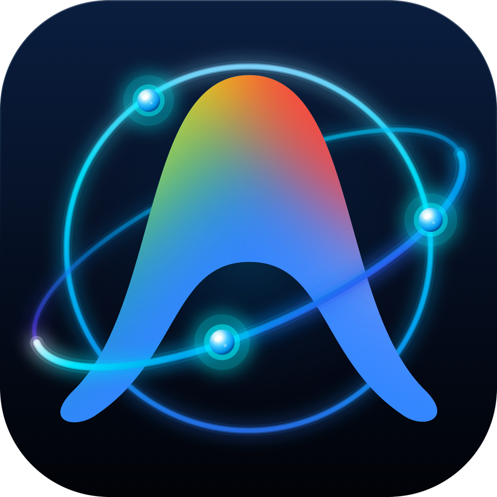

# 🪟 Antigravity Orbit (Windows 11 Edition)

<p align="center">
  
  <br>
  <em>Ứng dụng khay hệ thống (Taskbar System Tray) native Windows 11 viết bằng WinUI 3 & .NET 8, tự động giám sát quota và xoay vòng tài khoản Google AI Pro / Ultra cho Antigravity IDE, agy CLI & Antigravity Desktop App</em>
</p>

<p align="center">
  
  
  
  
</p>

---

## 📖 Giới thiệu

**Antigravity Orbit (Windows 11 Edition)** là phiên bản native 100% dành cho hệ điều hành Windows 11 và Windows 10 (từ bản 1809 trở lên), được xây dựng trên nền tảng **WinUI 3 (Windows App SDK)** và **C# / .NET 8**.

Ứng dụng mang trọn vẹn ngôn ngữ thiết kế **Fluent Design** với hiệu ứng nền kính mờ **Mica Material**, chạy ngầm nhẹ nhàng trên khay hệ thống Taskbar (Notification Area) và tích hợp sâu với **Windows Credential Manager (`wincred`)** để đồng bộ tức thời với `agy` CLI.

---

## 🌟 Tính năng nổi bật

1. **Khay hệ thống Taskbar (System Tray) Tinh gọn**:
   * Hiển thị icon sắc nét với tooltip thời gian thực: Email, Model AI active, hạn mức 5 giờ và hạn mức tuần.
   * Menu chuột phải nhanh: Xoay vòng tài khoản ngay lập tức (`Ctrl+R`), làm mới quota, mở cửa sổ Cài đặt, thoát ứng dụng (`Ctrl+Q`).
   * Click chuột trái để bật/tắt nhanh cửa sổ cài đặt.
2. **Đồng bộ 3 chiều (3-Way Target Sync)**:
   * **Antigravity IDE**: Cập nhật trực tiếp `%USERPROFILE%\.gemini\google_accounts.json` và `oauth_creds.json`.
   * **agy CLI & Go**: Tự động lưu trữ token vào **Windows Credential Manager** (`wincred.dll`) với thuộc tính `TargetName = "gemini:antigravity"`, đảm bảo `agy` CLI nhận token mới không bị gián đoạn.
   * **Antigravity Desktop App**: Đồng bộ phiên đăng nhập.
3. **Cơ chế Xoay vòng Round-Robin & Tự động Làm mới Token (Proactive Refresh)**:
   * Quét và chuyển sang tài khoản có quota tốt nhất khi quota $\le$ ngưỡng thiết lập (mặc định 10%).
   * Tự động làm mới access token khi còn dưới 120 giây hoặc gặp mã lỗi 401.
4. **Thông báo Windows 11 Action Center (Toast Notifications)**:
   * Gửi thông báo nổi góc màn hình kèm âm thanh chuẩn Windows 11 khi tự động xoay vòng tài khoản thành công.
5. **Khởi động cùng Windows 11 (Autostart)**:
   * Tự động chạy ẩn xuống khay Taskbar khi đăng nhập thông qua Registry `HKEY_CURRENT_USER\Software\Microsoft\Windows\CurrentVersion\Run`.

---

## 🛠 Hướng dẫn Build từ Mã nguồn

### Yêu cầu:
* Hệ điều hành: Windows 11 hoặc Windows 10 (Build 19041 trở lên)
* [.NET 8.0 SDK](https://dotnet.microsoft.com/download/dotnet/8.0)
* [Visual Studio 2022](https://visualstudio.microsoft.com/) (với workload *.NET Desktop Development*) hoặc Visual Studio Code kèm extension *C# Dev Kit*

### Lệnh build:
```powershell
# Chạy script PowerShell tự động build và đóng gói ZIP
.\build.ps1

# Hoặc dùng lệnh dotnet CLI trực tiếp:
dotnet publish .\AntigravityOrbit\AntigravityOrbit.csproj `
    -c Release `
    -r win-x64 `
    --self-contained true `
    /p:PublishSingleFile=true `
    /p:WindowsPackageType=None `
    -o .\dist
```

File thực thi độc lập `AntigravityOrbit.exe` sẽ được tạo trong thư mục `windows\dist\`, người dùng có thể chạy trực tiếp mà không cần cài đặt thêm .NET runtime.

